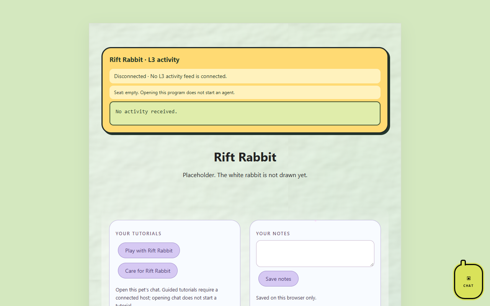

# Rift Rabbit

*A pet app by Astra.*

A white rabbit that preps and tracks VR software and performance. Part of [Astra's Pet Apps](https://github.com/findastra/astras-pet-apps).

## Pictures

Rift Rabbit's program page (`index.html`) as it looks on OpenAI Codex's `codex/l3-activity-20261016` branch, which adds the L3 activity bubble, tutorials and notes and is not merged into `main` yet. The app itself is a placeholder.

Screenshots taken 2026-10-17 with GitHub Goldfish's [project-image-generator](https://github.com/findastra/github-goldfish#project-image-generator); added with Claude Opus 5.5 (`claude-opus-5-5`), 2026-10-17.

## Status

Hatching: this is a placeholder. The repo holds the folder, the registry file and a blank page. Nothing tracks or preps yet, and the rabbit has no finished art.

## How to run it

Double-click `index.html`. It needs no install and no build step.

## Next steps

See [docs/handoff-claude-20261009.md](docs/handoff-claude-20261009.md).

## Limits

- No VR software or performance tracking yet.
- No pixel art yet. `sprite.json` only lists the nine moods.
- Not in the Cage yet. Registering it is [card 008](https://github.com/findastra/astras-pet-apps/blob/main/handoffs/008-farmer-register-new-placeholders.md) for the Friendly Farmer.

Desktop appearance draft updated 2026-10-11: see [desktop details](https://raw.githubusercontent.com/findastra/astras-pet-os/main/desktop-art/rift-rabbit/desktop-pet-20261011.json). This changes the desktop pet, not application features.
